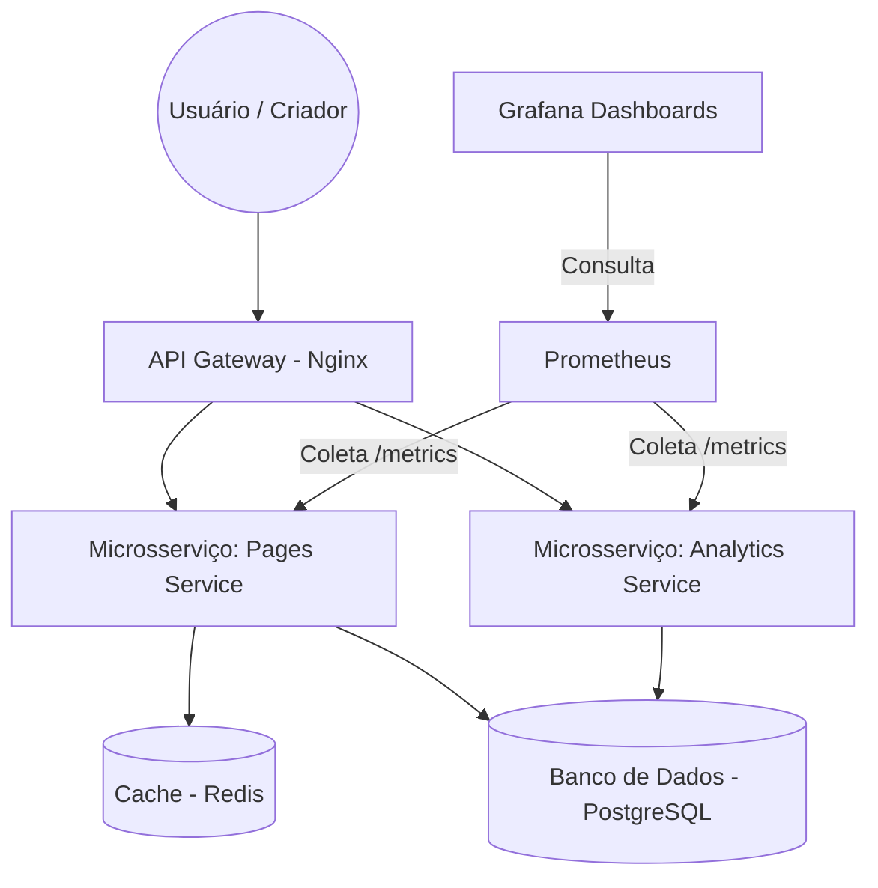

# SaaS de Páginas de Link na Bio Personalizadas para Criadores

## Integrantes da Equipe
- [Nome Completo do Integrante 1]
- [Nome Completo do Integrante 2]

## Descrição do Projeto
Plataforma SaaS baseada em microsserviços que permite a criadores de conteúdo gerenciar páginas personalizadas de link na bio com mini blocos de conteúdo, captura de leads, otimização de SEO e rastreamento de cliques em tempo real.

## Motivos da Seleção do Projeto
Escolhemos este projeto por se encaixar perfeitamente em uma arquitetura de microsserviços com alta demanda de escalabilidade. Quando um criador publica um link viral, o microsserviço de exibição de páginas recebe picos de acesso e escala automaticamente via Kubernetes (HPA), enquanto os serviços de analytics e banco de dados operam de forma isolada e monitorada via Prometheus e Grafana.

## Diagrama de Arquitetura (UML - Componentes)


## Como Executar
### Via Docker Compose
```bash
docker-compose up --build -d
```
- API Gateway: `http://localhost:8080/pages/criador1`
- Documentação Swagger: `http://localhost:8000/docs` e `http://localhost:8001/docs`
- Grafana: `http://localhost:3000` (admin/admin)

### Via Kubernetes
```bash
kubectl apply -f k8s/
kubectl get pods
kubectl get hpa
```